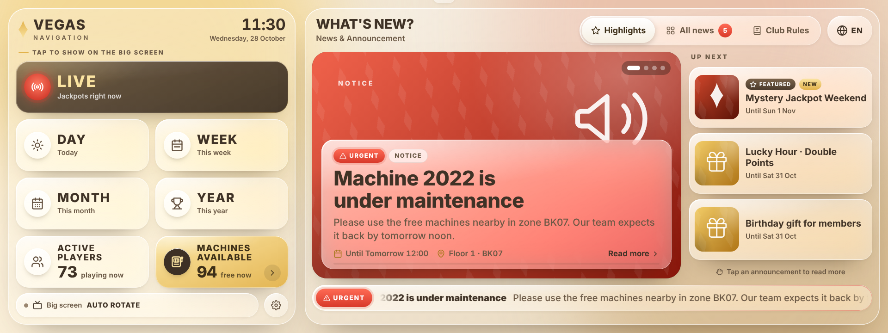
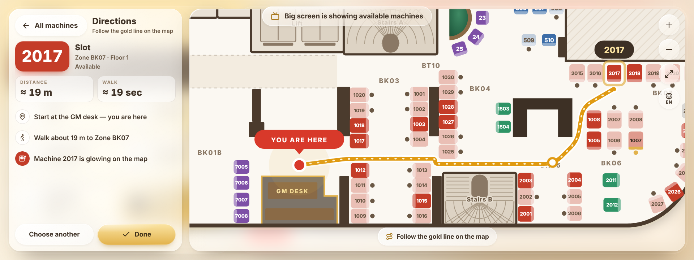
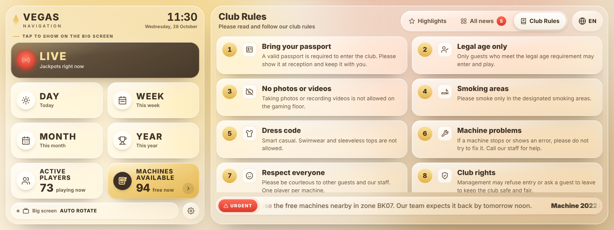

# Vegas Navigation

Bảng điều khiển cho màn hình bar 1920×720 đặt tại quầy GM của Vegas Club.

- **Bên trái (1/3):** các nút Live, Day, Week, Month, Year, Active Players và Machines Available để chuyển màn hình Jackpot Dashboard trên TV. Nút Machines Available mở bản đồ 2 tầng; khách chạm vào máy trống để xem đường đi từ quầy GM.
- **Bên phải (2/3):** thông báo của câu lạc bộ (màn hình chờ, tất cả thông báo, chi tiết) và mục Club Rules.
- 5 ngôn ngữ cho khách: English, 한국어, Tiếng Việt, 中文, 日本語.





## Nội dung thư mục

| Tệp | Dùng để |
| --- | --- |
| `index.html` | Toàn bộ ứng dụng trong một tệp. Đây là tệp GitHub Pages sẽ mở. |
| `dashboard-remote.js` | Đoạn mã dán vào Jackpot Dashboard để nhận lệnh từ màn hình bar. |
| `src/` | Mã nguồn tách nhỏ. Sửa ở đây rồi chạy `bash src/build.sh` để tạo lại `index.html`. |
| `docs/` | Ảnh chụp màn hình cho trang này. |
| `.nojekyll` | Báo GitHub Pages phục vụ tệp nguyên trạng. |

## Đưa lên GitHub

**Cách 1 — trên trình duyệt (không cần cài gì):**

1. Vào github.com → **New repository** → đặt tên `vegas-navigation` → **Create repository**.
2. Bấm **uploading an existing file**, kéo toàn bộ nội dung thư mục này vào (cả thư mục `src` và `docs`), rồi **Commit changes**.
   Tệp `.nojekyll` bị ẩn trên một số máy; nếu không kéo được thì bỏ qua, ứng dụng vẫn chạy.

**Cách 2 — dòng lệnh:**

```bash
cd vegas-navigation
git init
git add .
git commit -m "Vegas Navigation"
git branch -M main
git remote add origin https://github.com/<tên-tài-khoản>/vegas-navigation.git
git push -u origin main
```

## Bật GitHub Pages

1. Trong repository: **Settings → Pages**.
2. **Source:** *Deploy from a branch* → Branch **main**, thư mục **/ (root)** → **Save**.
3. Sau khoảng 1 phút, ứng dụng có tại `https://<tên-tài-khoản>.github.io/vegas-navigation/`.

> Lưu ý: trang GitHub Pages ai có địa chỉ cũng mở được (kể cả khi repository để riêng tư, trừ gói Enterprise). Sơ đồ câu lạc bộ sẽ xem được công khai qua địa chỉ đó.

## Chạy trên màn hình bar

- Mở địa chỉ trên bằng Chrome, bấm **F** để vào toàn màn hình.
- Chạy luôn ở chế độ kiosk (Windows):
  ```
  "C:\Program Files\Google\Chrome\Application\chrome.exe" --kiosk https://<tên-tài-khoản>.github.io/vegas-navigation/
  ```
- Ứng dụng tự co giãn theo màn hình; đẹp nhất ở 1920×720.
- Không ai chạm trong 60 giây thì tự về màn hình chờ và ngôn ngữ mặc định.

## Cài đặt cho nhân viên

Mở bằng một trong ba cách:

- Giữ nút bánh răng (cuối cột bên trái, cạnh ô "Big screen") **1,5 giây**.
- Bấm phím **S** trên bàn phím.
- Thêm `#admin` vào cuối địa chỉ, ví dụ `…/vegas-navigation/#admin`.

Trong cài đặt có: thông báo (kèm bản dịch từng ngôn ngữ, ảnh, thời gian hết hạn, mức ưu tiên), quy định câu lạc bộ, màn hình chờ, nền và giao diện, bật/tắt từng nút, khoá PIN, trạng thái máy trên bản đồ, vị trí quầy GM, lối lên tầng 2, và kết nối Dashboard.

## Dữ liệu được lưu ở đâu

Bản GitHub chạy độc lập, **lưu dữ liệu trong trình duyệt của từng máy** (localStorage). Vì vậy:

- Sửa thông báo trên máy nào thì máy đó thấy. Máy khác không tự cập nhật.
- Để chuyển dữ liệu sang máy khác: **Cài đặt → Tính năng → Sao lưu dữ liệu → Tải file sao lưu**, rồi trên máy kia chọn **Nhập file sao lưu**.
- Xoá dữ liệu trình duyệt (cookie/site data) sẽ mất dữ liệu. Nên tải file sao lưu định kỳ.
- Lần mở đầu tiên, ứng dụng dùng cài đặt đang có trên bản Claude (lời chào "WHAT'S NEW?", trạng thái máy) cùng bộ thông báo và quy định mẫu. Hãy sửa hoặc xoá các mục có nhãn **Mẫu**.
- Nút "Tự dịch bằng Claude" chỉ có ở bản chạy trên Claude. Ở bản GitHub, nhập bản dịch trực tiếp trong từng tab ngôn ngữ.

Cần nhiều màn hình và điện thoại nhân viên dùng chung dữ liệu theo thời gian thực thì dùng bản trên Claude, hoặc bổ sung một máy chủ lưu trữ (Firebase, Supabase…) — phần đó chưa có trong mã này.

## Kết nối Jackpot Dashboard

Nút trên màn hình bar gửi lệnh qua `BroadcastChannel('vegas-jackpot')`. Lệnh tới được Dashboard khi:

1. Hai trang **cùng một địa chỉ gốc**, ví dụ để Jackpot Dashboard trong cùng repository này (`dashboard.html`) → cùng `https://<tên-tài-khoản>.github.io`.
2. Hai trang chạy **trên cùng một máy tính và cùng một trình duyệt** (ví dụ một máy mini PC nối cả màn hình bar và TV; mở Dashboard ở cửa sổ thứ hai, kéo sang TV).
3. Jackpot Dashboard đã dán đoạn mã trong `dashboard-remote.js` vào bên trong thẻ `<script>`, ngay dưới hàm `go()`.

Khi đã kết nối, chấm ở ô "Big screen" chuyển sang màu xanh. Có thể bấm thử ở **Cài đặt → Kết nối Dashboard → Gửi thử**.

Ngoài ra có tuỳ chọn **Webhook**: mỗi lần khách chọn, ứng dụng gọi một địa chỉ bạn nhập (ví dụ `http://192.168.1.20:8080/nav?view={view}`), dùng khi TV chạy trên máy khác và có phần mềm nhận lệnh riêng.

## Sửa mã nguồn

```bash
bash src/build.sh   # tạo lại index.html từ các tệp trong src/
```

| Tệp trong `src/` | Nội dung |
| --- | --- |
| `head.html` | Tiêu đề trang, font, toàn bộ CSS |
| `body.html` | Biểu tượng SVG và khung giao diện |
| `seed.js` | Cài đặt dùng cho lần mở đầu tiên |
| `core.js` | Trạng thái, cài đặt mặc định, lưu trữ |
| `strings.js` | Chữ hiển thị cho khách bằng 5 ngôn ngữ |
| `samples.js` | Thông báo và quy định mẫu |
| `floor.js` | Sơ đồ: vị trí từng máy, khu, phòng, cầu thang |
| `map.js` | Vẽ bản đồ và tìm đường |
| `ui.js` | Màn hình bên trái, thông báo, bản đồ |
| `admin.js` | Cài đặt nhân viên |

Số máy ở khu vàng (301–317) và khu ô liu tầng 2 (30xx) là số tạm vì ảnh sơ đồ không đọc rõ; sửa trong `src/floor.js`.
